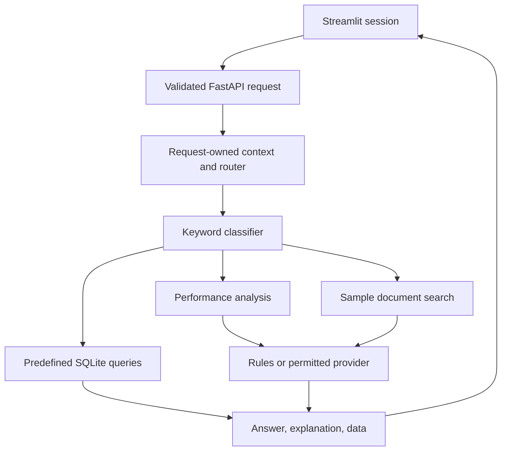

# Implementation and limitations

`students`, `attendance`, and `marks` hold 25, 25, and 75 synthetic rows respectively. The original committed database was compared against every fixture record and matched exactly before being removed from tracking. Initialization is explicit, not an import side effect. Local databases and bytecode are regenerated and ignored.

The classifier uses keyword priority: analytical, then knowledge, then data. Data handlers choose predefined SQL helpers rather than executing model-generated SQL. Document search scores keyword overlap in text sections; it has no embeddings, vector database, or citation-verification layer. Query coverage is limited by those heuristics.

Each request builds its own `ContextEngine` and `LLMRouter`. The UI submits only its most recent three completed exchanges. Provider keys are not saved to a process-global router, and Gemini's REST requests avoid a globally configured SDK. Operator-provided environment keys remain operator-owned credentials and must not be exposed through an untrusted deployment.

Cloud routing requires operator permission and request consent. Explicit provider modes do not silently switch providers. Auto mode can try other permitted providers after a failure, with at most one attempt per provider and bounded HTTP timeouts. Token counts estimate characters divided by four and should not be used to claim cost savings or performance results.

The role field changes response context only. All demo records are accessible to any admitted API client. The optional shared API token is not RBAC; local-only binding and loopback checks are the default operating boundary. Streamlit should also stay bound to loopback. Reverse proxies must not be used to make this prototype public without an independent authenticated access layer.

The original hackathon deck described React, PostgreSQL, FAISS, MCP, and secure role filtering. Those statements do not describe this code. The deck and obsolete implementation proposal were removed from the application tree; this document describes the implemented system.

Possible future work includes authenticated users with per-record policies, permission-aware retrieval, source-attributed answers, deterministic integration coverage for real providers, classification evaluation, and measured latency/cost comparisons. These are future work, not shipped capabilities.
