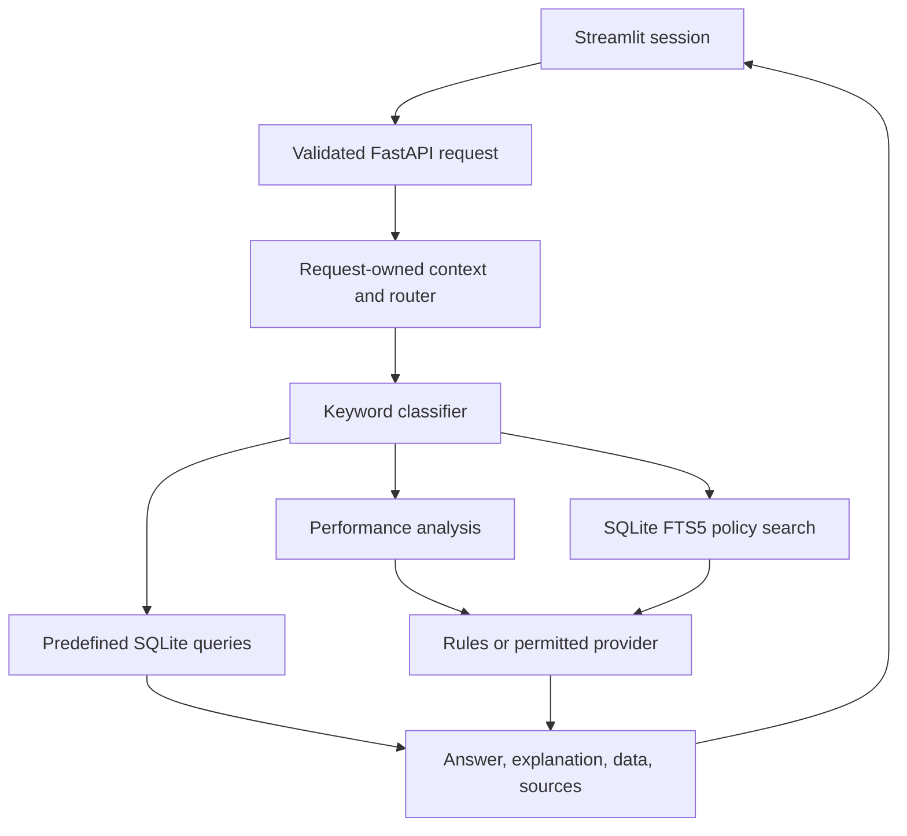

# Implementation and limitations

`students`, `attendance`, and `marks` hold 25, 25, and 75 synthetic rows respectively. The original committed database was compared against every fixture record and matched exactly before being removed from tracking. Initialization is explicit, not an import side effect. Local databases and bytecode are regenerated and ignored.

The classifier routes the explicit improvement-exam phrase to policy search, then checks analytical, knowledge, and data keywords in that order. Data handlers choose predefined SQL helpers. Policy search indexes the numbered sections in the bundled text files in a per-search in-memory SQLite FTS5 table. It uses English stemming, weighted BM25 scores that favor titles, and a stable document-order tie-break. Rebuilding this small index on each search lets file edits take effect immediately without synchronizing a separate database. The API returns up to three ranked matches with a filename, heading, exact line range, and excerpt.

Offline policy answers display the retrieved text. When synthesis is allowed, the model receives those same excerpts and is asked to cite their numbers. The source panel shows the evidence sent to the model, whose claims and citation choices still require review.

Each request builds its own `ContextEngine` and `LLMRouter`. The UI submits only its most recent three completed exchanges. Provider credentials come from the backend process environment and are excluded from the query schema. The status endpoint returns configuration flags without probing providers.

Cloud routing requires operator permission and request consent. Explicit provider modes do not silently switch providers. Auto mode can try other permitted providers after a failure, with at most one attempt per provider and bounded HTTP timeouts. Token counts estimate characters divided by four and should not be used to claim cost savings or performance results.

The role field changes response context only. All demo records are accessible to any admitted API client. The optional shared API token is not RBAC; local-only binding and loopback checks are the default operating boundary. Streamlit should also stay bound to loopback. Reverse proxies must not be used to make this prototype public without an independent authenticated access layer.

The original hackathon deck described React, PostgreSQL, FAISS, MCP, and secure role filtering. Those statements do not describe this code. The deck and obsolete implementation proposal were removed from the application tree; this document describes the implemented system.

Possible future work includes authenticated users with per-record policies, permission-aware retrieval, automated verification of model citations, deterministic integration coverage for real providers, classification evaluation, and measured latency/cost comparisons. These are future work, not shipped capabilities.
