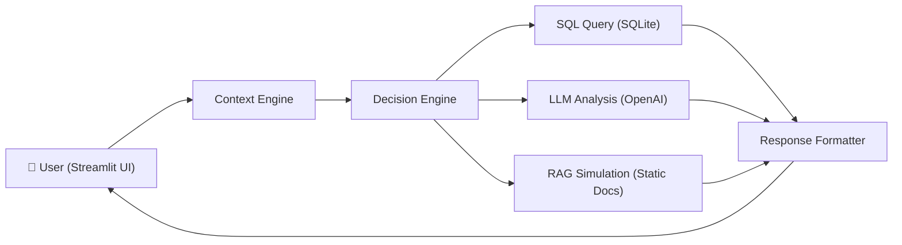

# AI-Powered College Data Assistant — Implementation Plan

Build a complete working prototype of an AI-powered college data assistant with natural language querying, context/decision engines, and a Streamlit chat UI.

## Proposed Architecture



## Tech Stack

| Layer | Technology |
|-------|-----------|
| Backend API | FastAPI (Python) |
| Frontend | Streamlit |
| Database | SQLite |
| LLM | OpenAI API (with rule-based fallback) |

## Proposed Changes

### Project Structure

```
Ai-college-management-system-/
├── main.py              # FastAPI backend server
├── db.py                # Database setup, schema, sample data, query helpers
├── logic.py             # Context Engine + Decision Engine + LLM integration
├── app.py               # Streamlit frontend (chat UI)
├── knowledge_base/      # Static documents for RAG simulation
│   ├── policies.txt     # College policies
│   └── guidelines.txt   # Academic guidelines
├── requirements.txt     # Python dependencies
├── .env.example         # Environment variable template (OpenAI key)
└── README.md            # Setup & run instructions
```

---

### Database Layer

#### [NEW] [db.py](file:///c:/Users/Parth/OneDrive/Dokumen/Personal%20info/Project%20ideas/Ai-college-management-system-/db.py)

- **Schema**: Three tables — `students(id, name, branch, year)`, `attendance(student_id, percentage)`, `marks(student_id, subject, score)`
- **Sample data**: 25 students across branches (CSE, ECE, ME, CE) and years (1–4), with realistic attendance percentages and marks across 3 subjects each
- **Helper functions**: `execute_query()`, `get_all_students()`, `get_low_attendance()`, `get_student_marks()`, etc.
- Auto-creates and seeds the database on first import

---

### Logic Layer (Context + Decision Engines)

#### [NEW] [logic.py](file:///c:/Users/Parth/OneDrive/Dokumen/Personal%20info/Project%20ideas/Ai-college-management-system-/logic.py)

**Context Engine:**
- Maintains session state: `user_role` (student/teacher/admin) and `session_memory` (last 3 queries)
- Enriches incoming queries with role context and conversation history

**Decision Engine:**
- Classifies queries into 3 categories using keyword matching:
  1. **Data queries** (attendance, marks, students list) → generates and runs SQL
  2. **Analytical queries** (analyze, suggest, identify weak, performance trends) → fetches relevant data + sends to LLM for insights
  3. **Knowledge queries** (policy, guidelines, eligibility, rules) → RAG simulation using static docs
- Each path returns structured response with `answer`, `explanation`, and `query_type`

**LLM Integration:**
- Primary: OpenAI `gpt-3.5-turbo` API call with structured prompt
- Fallback: Rule-based analysis engine that flags students with attendance < 60% and marks < 50%, generates simple insights
- The fallback is fully functional — the app works without an API key

**RAG Simulation:**
- Reads static `.txt` documents from `knowledge_base/`
- Uses keyword matching to find relevant passages
- Sends matched passages + query to LLM (or returns matched passages directly in fallback mode)

---

### Backend API

#### [NEW] [main.py](file:///c:/Users/Parth/OneDrive/Dokumen/Personal%20info/Project%20ideas/Ai-college-management-system-/main.py)

FastAPI app with the following endpoints:

| Endpoint | Method | Description |
|----------|--------|-------------|
| `/query` | POST | Accept `{query, role}`, run through Context → Decision engines, return structured response |
| `/health` | GET | Health check |

- Initializes DB on startup
- Manages session memory per request cycle
- Returns JSON: `{ answer, explanation, query_type, data }`

---

### Frontend (Streamlit)

#### [NEW] [app.py](file:///c:/Users/Parth/OneDrive/Dokumen/Personal%20info/Project%20ideas/Ai-college-management-system-/app.py)

- **Chat interface** with `st.chat_message` for conversation history
- **Sidebar**: Role selector (Student / Teacher / Admin), session info display
- **Response display**: Answer text + expandable "Explanation" section + optional data table
- Communicates with FastAPI backend via `requests`
- Maintains session memory in Streamlit session state

---

### Knowledge Base

#### [NEW] knowledge_base/policies.txt
College policies document covering attendance requirements (75% minimum), exam eligibility rules, disciplinary policies.

#### [NEW] knowledge_base/guidelines.txt
Academic guidelines covering grading system, improvement exams, remedial classes for weak students.

---

### Configuration

#### [NEW] requirements.txt
```
fastapi
uvicorn
streamlit
openai
python-dotenv
requests
```

#### [NEW] .env.example
```
OPENAI_API_KEY=your_api_key_here
```

#### [NEW] README.md
Complete setup and run instructions.

---

## Supported Example Queries

| Query | Engine Path |
|-------|-------------|
| "Show students with attendance below 60%" | Data → SQL |
| "Identify weak students and suggest improvements" | Analytical → LLM/Fallback |
| "Analyze performance of CSE 3rd year students" | Analytical → LLM/Fallback |
| "What is the minimum attendance policy?" | Knowledge → RAG |
| "List all students in ECE branch" | Data → SQL |
| "Who are the top performers?" | Analytical → LLM/Fallback |

## Verification Plan

### Automated Tests
1. Run `python db.py` — verify database creation and 25 students inserted
2. Start FastAPI: `uvicorn main:app --reload` — verify `/health` returns OK
3. Test `/query` endpoint with each example query type via curl or Streamlit
4. Start Streamlit: `streamlit run app.py` — verify chat UI loads and queries work

### Manual Verification
- Walk through all 6 example queries in the Streamlit UI
- Verify structured responses with answer + explanation
- Test role switching (student/teacher/admin)
- Test without OpenAI API key to confirm fallback works
